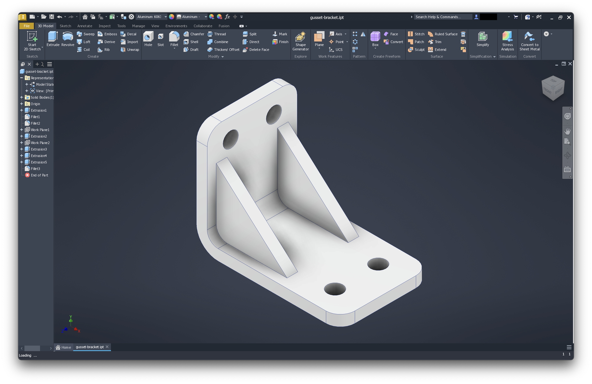
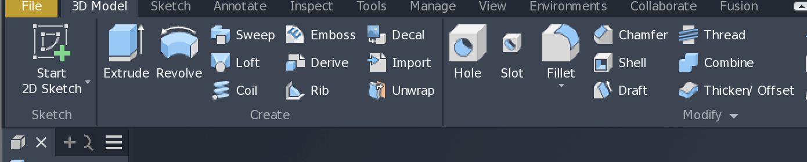

# inventor-on-macos

Run **Autodesk Inventor 2027** on an Apple Silicon Mac – as ordinary macOS
windows, without a virtual machine or a Windows desktop.



It is a macOS port of the
[Autodesk-Inventor-for-Linux](https://github.com/Harvi654/Autodesk-Inventor-for-Linux)
project: Wine 11.20 with the [winum](https://github.com/Harvi654/winum) Inventor
patch series, built for x86_64 and run through Rosetta 2, with
[DXMT](https://github.com/3Shain/dxmt) turning Direct3D 11 into Metal for the 3D
viewport, plus a patch to Wine's macOS driver that makes Inventor behave like a
Mac app.

> **Not affiliated with or endorsed by Autodesk.** No Autodesk software is
> included. You need your own Inventor installer and a valid licence
> (commercial, trial or education).

| | |
|---|---|
|  |  |
| Full Retina resolution with 200 % Windows scaling | |

## Status

| Works | |
|---|---|
| Offline install (ODIS), .NET 4.8, WebView2 runtime, Content Center | ✅ |
| Autodesk sign-in and licensing (browser sign-in, see below) | ✅ |
| Part modelling, 3D viewport through Metal (DXMT) | ✅ |
| Inventor COM/.NET API (see [examples](examples/automation)) | ✅ |
| Native macOS windows: Retina, app name, resize, drag | ✅ |
| macOS tiling, full screen and Split View | ✅ |

| Known limitations | |
|---|---|
| WebView2 panes (Home tab, licence dialog) are blank – macOS can't show another process's child window. Sign in with `scripts/sign-in.sh`; use *File → New/Open* instead of Home | ⚠️ |
| Runs under Rosetta 2 (x86_64), so heavy assemblies are slower than on a PC | ⚠️ |
| Inventor CAM, Nastran, Vault, assemblies and drawings at scale: not tested yet | ❔ |

## Requirements

* Apple Silicon Mac, macOS 15 (developed on an M4, macOS 15.7)
* [Homebrew](https://brew.sh), Xcode command line tools, Rosetta 2
* ~45 GB free disk (Wine build 4 GB, prefix ~19 GB, unpacked installer 7 GB)
* Autodesk's **offline** Inventor 2027 installer: `Inventor_Professional_2027_English_Win_64bit_db_001_002.exe`
  and `..._db_002_002.7z` (Safari may save the `.7z` as `.dms` – that's fine)

## Install

```sh
git clone https://github.com/h04x3d/inventor-on-macos.git
cd inventor-on-macos
./install.sh ~/Downloads/inventor-2027-offline     # folder with the two installer files
```

`install.sh` runs these steps in order (resume with `./install.sh --from <step> <folder>`):

| Step | Script | Time |
|---|---|---|
| `deps` | Homebrew packages, fonts, Rosetta | minutes |
| `wine` | build Wine 11.20 + winum + winemac.drv patch, assemble the runtime | ~30–60 min |
| `dxmt` | DXMT v0.80 into the runtime | seconds |
| `port` | clone the Linux project at a pinned commit, apply the macOS patch | seconds |
| `inventor` | Autodesk's installer inside Wine (with the .NET ngen watchdog) | ~1–2 h |
| `app` | `~/Applications/Autodesk Inventor 2027.app` + `adskidmgr://` handler | seconds |

Then sign in once:

```sh
scripts/sign-in.sh
```

It starts Inventor and presses *Sign in with your Autodesk ID* in the
(invisible) licence dialog. Finish signing in in your browser and click
**Open Product**. After that, start Inventor from **Autodesk Inventor 2027** in
`~/Applications`, or open `.ipt`/`.iam`/`.idw` files with it.

Keep your files in `~/Inventor` – Inventor sees it as drive `D:`. The prefix is
sandboxed and can't see the rest of your Mac.

> The steps in `install.sh` are the ones used to bring this up on a real
> machine, collected into scripts. If a step fails on yours, the logs and
> [troubleshooting](docs/troubleshooting.md) should get you going; issues and
> PRs are welcome.

## Automation example

Inventor's API works over COM as on Windows. With Inventor running:

```sh
examples/automation/run.sh Bracket.cs
```

builds the gusseted bracket in the screenshot (L-section, bend radii, two
gussets, four M8 holes, rounds) and saves it to `~/Inventor/Examples`. See
[examples/automation](examples/automation).

## Documentation

* [How it works](docs/how-it-works.md) – the stack, and everything that had to change for macOS
* [winemac.drv patch](docs/wine-patches.md) – each Wine change, why, and how to rebuild the driver
* [Troubleshooting](docs/troubleshooting.md)

## Credits

* [Harvi654/Autodesk-Inventor-for-Linux](https://github.com/Harvi654/Autodesk-Inventor-for-Linux)
  and [winum](https://github.com/Harvi654/winum) (from Lachlan's original inventor-on-linux) – nearly all of the hard Inventor-specific work
* [Wine](https://www.winehq.org), [Gcenx's macOS Wine builds](https://github.com/Gcenx/macOS_Wine_builds),
  [DXMT](https://github.com/3Shain/dxmt)

## Licence

Scripts, tools and examples: MIT (see [LICENSE](LICENSE)). The Wine patch is
LGPL-2.1-or-later, like Wine. The patch to the Linux project follows its MIT
licence. Autodesk, Inventor and Fusion are trademarks of Autodesk, Inc.
